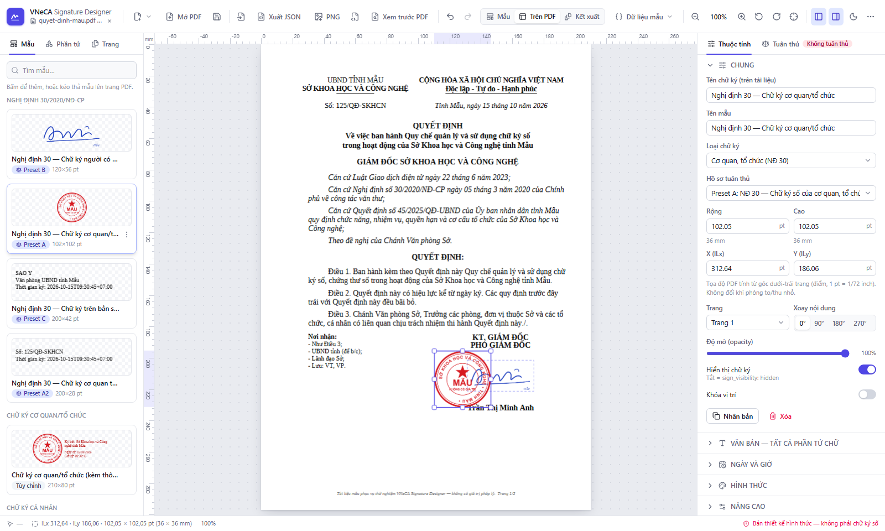

# VNeCA Signature Designer

Công cụ chạy trên trình duyệt để **thiết kế hình thức hiển thị (appearance) của chữ ký số trên tài liệu PDF**, có bộ mẫu theo **Nghị định 30/2020/NĐ-CP** và xuất cấu hình `sign_props` cho nền tảng ký số VNeCA.

> ⚠️ **Đây là công cụ thiết kế hình thức, không phải dịch vụ ký số hay CA.** Công cụ không tạo chữ ký số, không có chứng thư số và không chứng minh danh tính, sự đồng ý hay thẩm quyền của người ký. PDF xem trước luôn mang dòng chữ *“Đây là bản xem trước hình thức chữ ký, chưa phải tài liệu được ký số hợp lệ.”* và không chứa trường chữ ký (`/Sig`, `/ByteRange`).



## Tính năng chính

- **Mở PDF cục bộ** (PDF.js): mọi trang, ảnh thu nhỏ, thước đo mm/pt, lưới, đường căn chỉnh, thu phóng 25–400 % (Ctrl + cuộn quanh con trỏ), xoay khung nhìn, hỗ trợ `/Rotate`, CropBox/MediaBox, màn hình high-DPI. Tệp **không bao giờ** được tải lên máy chủ.
- **Đặt & chỉnh khung chữ ký** bằng kéo thả, 8 tay nắm, bắt dính cạnh/tâm/lưới, phím mũi tên; nhiều chữ ký trên một tài liệu; tọa độ lưu theo điểm PDF (gốc dưới-trái) nên **không đổi khi phóng to/thu nhỏ hay xoay khung nhìn**.
- **Trình soạn phần tử**: văn bản, họ tên, cơ quan, chủ thể/tổ chức cấp/serial chứng thư, ngày/giờ ký, lý do, nơi ký, ảnh chữ ký, ảnh dấu, logo, ảnh nền, mã QR, hình chữ nhật, đường kẻ; lớp, khóa, khóa tỉ lệ, ràng buộc bố cục kiểu Figma, hiển thị có điều kiện.
- **Biến động an toàn** `{{signer.name}}`, `{{signing.datetime}}`… (13 biến theo yêu cầu + 3 biến mở rộng cho NĐ 30), không dùng `eval`, không chèn HTML. Ba chế độ dữ liệu: *Biến*, *Dữ liệu mẫu*, *Dữ liệu thực tế*.
- **Thư viện 12 mẫu**: NĐ 30 (người có thẩm quyền, cơ quan/tổ chức, bản sao điện tử, văn bản kèm theo), cơ quan/tổ chức, cá nhân, cá nhân thuộc tổ chức, doanh nghiệp, bác sĩ, bệnh viện, hợp đồng điện tử, xác nhận, tùy chỉnh — kèm dữ liệu mẫu và ảnh thu nhỏ. Lưu mẫu riêng vào “Mẫu của tôi”.
- **Kiểm tra tuân thủ NĐ 30**: 46 quy tắc (ID, căn cứ pháp lý trích nguyên văn, đối tượng áp dụng, mức độ, giải thích); trạng thái *Tuân thủ / Cảnh báo / Không tuân thủ / Chưa đánh giá*; xác nhận thủ công cho các điểm phần mềm không kiểm chứng được; nhãn **Custom Mode** khi tùy biến ngoài quy định. Xem [DECREE30_COMPLIANCE.md](DECREE30_COMPLIANCE.md).
- **Ba chế độ xem trước**: *Mẫu* (không cần PDF), *Trên PDF*, *Kết xuất* (PDF sinh bằng pdf-lib, tải về được).
- **Xuất/nhập**: Designer JSON (đầy đủ, dựng lại chính xác), tệp mẫu, **VNeCA `sign_props`** (legacy, có cảnh báo cho mọi tính năng không hỗ trợ), PNG (300/600 DPI), SVG. Xem [VNECA_INTEGRATION.md](VNECA_INTEGRATION.md).
- Giao diện sáng/tối, tiếng Việt mặc định (có sẵn tiếng Anh cho giao diện), phím tắt (`?`), nhúng được vào VNeCA CMS qua `mount()`.

## Yêu cầu

- Node.js ≥ 20 (đã kiểm thử với Node 25.8, npm 11.11)
- Trình duyệt Chromium/Edge/Firefox/Safari bản mới

## Lệnh

```bash
cd web-demo/tool-design
npm install                     # cài phụ thuộc
npm run dev                     # chạy dev server: http://localhost:5180
npm test                        # unit + integration (Vitest)
npx playwright install chromium # lần đầu, để chạy E2E
npm run test:e2e                # Playwright E2E (tự khởi động dev server)
npm run build                   # bản production vào dist/
npm run preview                 # phục vụ bản build: http://localhost:5181
npm run samples                 # sinh lại các PDF mẫu trong public/samples
node scripts/capture-screenshots.mjs   # chụp lại ảnh màn hình docs (cần dev server đang chạy)
```

`predev`/`prebuild` tự chép tài nguyên PDF.js (CMaps, phông chuẩn, WASM) vào `public/pdfjs/` để chạy hoàn toàn offline.

## Tài liệu mẫu (`public/samples/`)

| Tệp | Nội dung |
|---|---|
| `quyet-dinh-mau.pdf` | Quyết định hành chính 2 trang theo thể thức NĐ 30, có khối chữ ký “KT. GIÁM ĐỐC / PHÓ GIÁM ĐỐC” |
| `hop-dong-dien-tu.pdf` | Hợp đồng dịch vụ chữ ký số 3 trang, 2 bên ký |
| `phieu-ket-qua-xet-nghiem.pdf` | Phiếu kết quả xét nghiệm (bệnh viện/bác sĩ) |
| `kiem-thu-xoay-trang.pdf` | 5 trang `/Rotate` 0/90/180/270 và CropBox lệch gốc — dùng kiểm thử tọa độ |

Mọi tổ chức, cá nhân, số liệu đều là giả lập; mỗi trang có chân trang “không có giá trị pháp lý”. Ảnh dấu/chữ ký đi kèm là **ảnh MẪU** (in chữ “MẪU”) và luôn không đạt quy tắc “ảnh thật”.

## Cấu trúc

```text
src/
  app/                 App shell, bootstrap phông & thư viện
  components/          UI: editor/, canvas/, pdf/, properties/, templates/, preview/, ui/
  engines/
    coordinate-engine/ Chuyển đổi PDF ↔ hiển thị ↔ viewport, snapping (thuần, có test)
    template-engine/   Mô hình mẫu, biến, ngày giờ, điều kiện, ràng buộc
    rendering-engine/  Bố cục chữ, renderer canvas / SVG / PDF, phông
    compliance-engine/ Quy tắc NĐ 30, phân tích ảnh, tổng hợp kết quả
  adapters/vneca/      Adapter sign_props (legacy) + registry cho nhà cung cấp khác
  schemas/             Zod: Designer Schema, Legacy Schema
  features/            Hành động: tài liệu, xuất/nhập, mẫu, đặt vị trí mặc định NĐ 30
  services/            PDF.js, phông, xử lý ảnh (trình duyệt)
  stores/              Zustand + lịch sử hoàn tác, lưu trữ cục bộ
  i18n/                vi (mặc định), en
tests/unit · tests/integration · tests/e2e
```

Chi tiết: [ARCHITECTURE.md](ARCHITECTURE.md).

## Bảo mật & quyền riêng tư

- PDF, ảnh và dữ liệu người ký xử lý **hoàn toàn trong trình duyệt**; không có request ra ngoài, không phông/asset từ CDN. Bản build có CSP chặt (`default-src 'self'`).
- PDF/văn bản/dữ liệu thực tế **không** được lưu tự động. Chỉ mẫu do người dùng bấm “Lưu mẫu” và tùy chọn giao diện được ghi vào `localStorage`.
- SVG tải lên được làm sạch bằng DOMPurify (loại script, sự kiện, `foreignObject`, liên kết ngoài) rồi chuyển sang PNG; JSON nhập vào được kiểm tra bằng Zod (chỉ chấp nhận ảnh PNG/JPEG data URL).
- Tệp được kiểm tra loại, kích thước (PDF ≤ 100 MB, ảnh ≤ 10 MB, JSON ≤ 25 MB) và chữ ký tệp; PDF có mật khẩu/hỏng bị từ chối với thông báo rõ ràng.

## Phông chữ

Mẫu dùng tên phông logic *Times New Roman* / *Arial*. Vì không được phép phân phối lại hai phông này, bản xem trước/PNG/SVG/PDF dùng **Liberation Serif / Liberation Sans** (SIL OFL 1.1, tương thích số đo, đủ dấu tiếng Việt) đóng gói trong `public/fonts/`. Dịch vụ ký số khi ký thật cần dùng đúng phông theo quy định.

## Giới hạn đã biết

Xem mục “Giới hạn” trong [ARCHITECTURE.md](ARCHITECTURE.md#giới-hạn-đã-biết) và các điểm cần VNeCA xác nhận trong [VNECA_INTEGRATION.md](VNECA_INTEGRATION.md#điểm-cần-vneca-xác-nhận).
